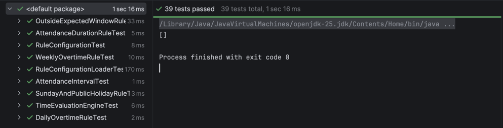
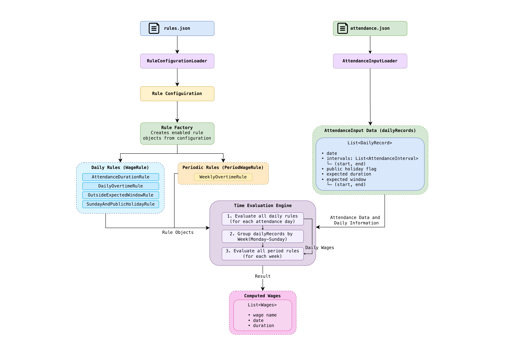

# Configurable Time Evaluation Engine

A Java backend that evaluates attendance data using configurable rules and produces **wages**. A wage here is a named time duration, not a monetary amount. Rules are defined in JSON, so they can be changed and combined without touching application code.

## Requirements

- JDK 25 <!-- CHECK: or lower this to 21 in pom.xml and here -->
- Maven 3.9+ <!-- CHECK: use the version you actually ran -->

## Build and run

```bash
mvn clean package
mvn exec:java -Dexec.args="<attendance-file> <rules-file>"
```

Arguments are positional: attendance file first, rules file second.

Example (Example A from the assignment):

```bash
mvn exec:java -Dexec.args="examples/example-a-attendance.json examples/rules.json"
```

The result is printed to stdout as named wages per date or period. <!-- CHECK: describe the real output format -->

## Tests

```bash
mvn test
```


The tests cover attendance duration, daily overtime, time outside the window, Sunday and public-holiday precedence, and the weekly/daily reconciliation (Examples A and B). <!-- CHECK: match to the actual tests -->

## Input format

**Attendance file**: one record per day:

| Field | Description |
|---|---|
| `date` | ISO date, e.g. `2026-10-26` |
| `intervals` | list of `{start, end}` times (HH:mm), may be empty |
| `publicHoliday` | boolean |
| `expectedDuration` | ISO-8601 duration, e.g. `PT8H` |
| `expectedWindow` | `{start, end}` expected working time window |

The weekday is derived from the date.

**Rules file** (`rules.json`): a list of rules. Each rule has a `type`, a wage `name`, rule-specific parameters, and an optional `enabled` flag. <!-- CHECK: show one real rule snippet here, copied from your rules.json -->

## Supported rules

| Rule | Result |
|---|---|
| Attendance duration | Sum of the day's intervals; gaps between them are excluded |
| Daily overtime | Attendance beyond the expected duration, never below zero; the applicable weekdays are configurable |
| Outside expected window | Attendance falling outside the expected time window |
| Sunday work | Attendance on a Sunday that is not a public holiday |
| Public-holiday work | Attendance on a public holiday (takes precedence over Sunday) |
| Weekly overtime | Weekly attendance beyond a threshold, reduced by daily overtime already counted |

### Weekly/daily reconciliation

Weekly overtime is reduced by the daily overtime already accounted for, with a minimum of zero. Daily overtime stays unchanged.

With daily overtime above 8 h on Monday to Friday and weekly overtime above 40 h over all seven days:

| Example | Daily OT before | Weekly OT before | Reported daily OT | Reported weekly OT |
|---|---|---|---|---|
| A | 4 h | 2 h | 4 h | 0 h |
| B | 2 h | 6 h | 2 h | 4 h |

## Design & Architecture



- `DailyRecord` holds one day's data.
- **Daily rules** evaluate a single `DailyRecord` and produce wages for that date.
- **Period rules** evaluate all records of one week and can read the daily wages, which is how weekly overtime avoids double-counting.
- `RuleFactory` builds rule instances from the JSON configuration.
- `TimeEvaluationEngine` orchestrates the daily pass, then the weekly pass, and collects the wages.

## Assumptions

- One employee.
- Intervals are valid, non-overlapping, and within a single day.
- Minute precision.
- Weeks run Monday to Sunday.
- Input covers complete evaluation periods.
- A day that is both Sunday and a public holiday produces only the public-holiday wage.

## Trade-offs

- Zero-duration wages are kept for attendance duration, daily overtime and outside-window rules. Sunday and public-holiday wages are omitted when there was no attendance.
- Existing rules can be configured and combined without code changes. A new rule *type* needs a Java implementation registered in `RuleFactory`.
- JSON was chosen over a custom DSL for simplicity and tooling support.

## Not done / limitations

- Monthly aggregation is not implemented. <!-- CHECK: delete if it is -->
- Rules are evaluated in the configured order; there is no dependency resolution between rules beyond the daily-then-weekly passes.
- Minimal validation of malformed configuration. <!-- CHECK: adjust to reality -->